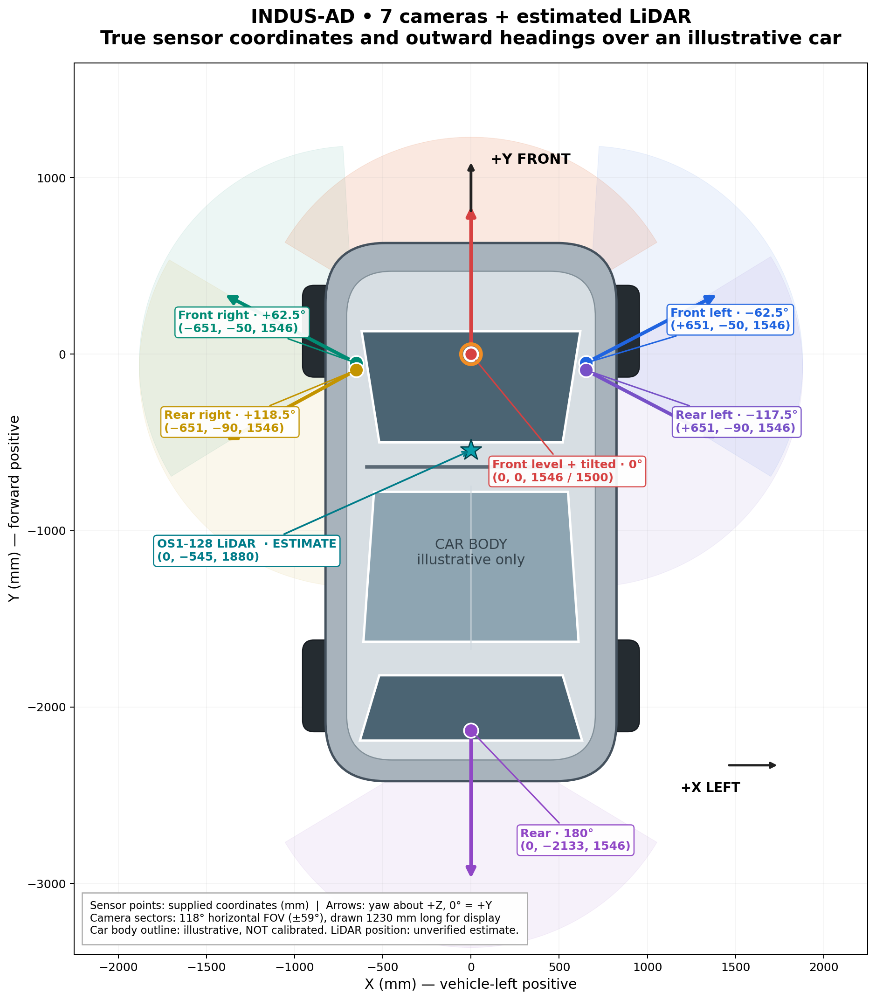

# Indus-AD Devkit

[](https://www.python.org/)
[](https://github.com/gagandeepreehal/indus-ad-devkit/actions/workflows/ci.yml)
[](https://github.com/gagandeepreehal/indus-ad-devkit/releases/tag/v0.1.2)

[](LICENSE.md)

Build reproducible, nuScenes-compatible subsets from INDUS-AD driving datasets.
The devkit selects camera frames and driving scenes, interpolates GNSS poses,
applies scenario quotas, and exports validated train/test splits with provenance.

Integrated INDUS-AD support includes camera, semantic, depth, weather, and optional
GNSS weak pseudo-labels. These model outputs remain separate from human labels.

> Compatibility refers to the nuScenes file structure and supported loader behavior.
> This project is independent of Motional and does not reproduce the nuScenes
> sensor suite, annotations, maps, or benchmarks.

## Quickstart

Requires Python 3.12 (`>=3.12,<3.13`) and Linux or macOS. First request access to
[INDUS-AD on Hugging Face](https://huggingface.co/datasets/gagandeepreehal/indus-ad)
and wait for approval. Keep credentials out of configuration files.

The example downloads about **209 MB / 199 MiB** of source artifacts. Allow a
**2 GiB working budget plus the Python environment**; installation and network
overhead are additional. Dense semantic/depth archives are disabled.

Run from a fresh checkout:

```bash
git clone https://github.com/gagandeepreehal/indus-ad-devkit.git
cd indus-ad-devkit
python3.12 -m venv .venv
source .venv/bin/activate
python -m pip install -e .
hf auth login
cp examples/indus_ad_v21_config.json dataset_config.json
cp examples/indus_ad_annotations.jsonl annotations.jsonl
indus-ad build --config dataset_config.json
indus-ad validate --dataroot var/indus-ad-datasets/v1.0-trainval --version v1.0-trainval
indus-ad inspect --dataroot var/indus-ad-datasets/v1.0-trainval --version v1.0-trainval
```

Expected output: **1 scene, 48 samples and 288 camera images**, with 2 joined
camera pseudo-label rows and 4 dense references. A verified macOS build using
cached source artifacts took about 60 seconds; cold downloads take additional time.
See [quickstart measurements, provenance and limits](docs/quickstart-release.md).

`indus-ad` is the primary CLI command. The legacy `dataset-devkit` command remains
available as a compatibility alias for existing scripts.

The commands install the current checkout. Release v0.1.2 includes the revised
configuration. The example bundled with the immutable v0.1.1 tag differs;
use the configuration from this release. See the verification guide for the
original measurements and the current production acceptance results.

The mandatory official nuScenes loader check depends on NumPy <2;
Python 3.13/3.14 are unsupported until that dependency chain is compatible.

## Source dataset


*Illustrative surround view from the INDUS-AD dataset card; not a calibrated camera-layout diagram
or independent evidence of anonymization performance. [Image source and license](docs/assets/SOURCES.md).*



Seven-camera and Ouster OS1-128 LiDAR configuration. Camera positions and orientations are plotted from supplied parameters; vehicle silhouette is illustrative, and LiDAR positioning is estimated and unverified.

[INDUS-AD on Hugging Face](https://huggingface.co/datasets/gagandeepreehal/indus-ad)
contains multi-camera driving recordings from Bengaluru, India, with camera timing,
calibration, transformed GNSS/pose tables, and sampled semantic, depth, weather, and
image-quality pseudo-labels joined by `recording_id`.

| Dataset-card snapshot | Value |
| --- | --- |
| Recordings | 1,469 |
| Camera videos | 9,927 MP4s |
| Recording timeline (longest camera per recording) | 85.31 hours |
| Summed camera-view duration | 588.57 hours across cameras, not distinct driving hours |
| Camera positions | Six surround cameras; tilted-front video in 1,113 recordings |
| Sampled camera annotation rows | 34,306; not labels for every video frame |

Figures come from the [dataset card snapshot](https://huggingface.co/datasets/gagandeepreehal/indus-ad/blob/592780554157eb2b38eec1bbba9bb498da5878bb/README.md),
checked 16 October 2026. Its `train` split is a storage/API label, not an authored benchmark split.
The devkit creates its own derived train/test split. Dataset access requires manual approval;
the publisher handles privacy concerns and recording withdrawals manually through
[indus-ad@gagandeepreehal.com](mailto:indus-ad@gagandeepreehal.com). See the
[current dataset privacy policy](https://huggingface.co/datasets/gagandeepreehal/indus-ad/blob/main/collateral/DATASET_PRIVACY_AND_TAKEDOWN.md).


*Publisher-provided dataset-layer diagram. [Image source and license](docs/assets/SOURCES.md).*

## Choose a source

All sources require an exact repository ID and a full 40-character commit SHA.

| Source | Schema | Example |
| --- | --- | --- |
| Integrated INDUS-AD with annotations | `2.1`, `indus_ad_hf` | [indus_ad_v21_config.json](examples/indus_ad_v21_config.json) |
| Older decoded V2 layout | `2.0`, `decoded_hf` | [decoded_v2_config.json](examples/decoded_v2_config.json) |
| Original MCAP | `1.0`, `mcap_hf` | [dataset_config.json](examples/dataset_config.json) |

INDUS-AD and decoded V2 are classified as `privacy_transformed`; original MCAP is
restricted raw (`restricted_raw`) and carries no anonymization claim. Manifest verification
checks published evidence and integrity; it does not independently rerun the anonymizer.

## Configure a subset

The example pins dataset revision `ee0e1754964f6af000625fb42d854565b39fec36`
and selects recording `17-58-38.892-1cafd700d18c4a09a1f9db053c7933c1`.
It selects exactly one eligible scene through an explicit `quickstart` quota of 1;
an empty scenario-rules list selects no scenes. Dense archives are disabled.

The human annotation file is optional input content but must exist at its configured
path. The INDUS-AD template is empty and supplies no invented human labels.
The legacy MCAP and decoded V2 examples use placeholder repository IDs and all-zero
revisions; replace both with a source matching the corresponding contract.

The pipeline verifies selected artifacts, samples frames, builds scenes, applies
filters and seeded scenario quotas, and assigns train/test splits. Strict quota
shortfalls fail the build. For transformed sources, trajectories and motion features
use precise recording-local ENU; rounded global coordinates provide context only.

See [measured annotation coverage and exact-join examples](docs/annotation-coverage.md).
A regular sampling grid can retain no labels from a sparsely annotated recording;
inspect the export contract's `join_audit` before using it for supervision.

Six untilted cameras are selected by default; `cam_front_tilted` is optional. Dense
semantic/depth payloads are metadata-only by default. `selected_frames` modes require
`camera_scalar` and verify dense members after scene selection.

## Output and validation

A successful build publishes `paths.output_dir/v1.0-trainval`:

```text
v1.0-trainval/
├── maps/
├── samples/
├── mz_extensions/
└── v1.0-trainval/       # official JSON tables
```

`mz_extensions/` contains source fingerprints, validity, labels, selection/split
audits, and a content manifest. Integrated weak labels are Parquet tables under
`mz_extensions/indus_ad/`. Official object annotation tables remain empty.
Dense payloads stay in the verified cache; exported rows retain source references
and materialization state. Dense acquisition failures block publication.

```bash
indus-ad validate --dataroot var/indus-ad-datasets/v1.0-trainval --version v1.0-trainval
indus-ad inspect --dataroot var/indus-ad-datasets/v1.0-trainval --version v1.0-trainval
```

These commands use the quickstart output path; adjust it if you change the configuration.
Paths are relative to the configuration file. Outputs are read-only and existing
destinations are never overwritten. Rebuild into a new destination to change content.
Commands emit JSON; configuration errors exit `2`, and operational/validation errors exit `1`.

## Python SDK

```python
from dataset_devkit import Dataset

dataset = Dataset("var/indus-ad-datasets/v1.0-trainval")
scene = dataset.table("scene")[0]
sample = dataset.scene_samples(scene["token"])[0]
front = dataset.camera(sample["token"], "CAM_FRONT")
pose = dataset.ego_pose(front["token"])

# Integrated INDUS-AD output
labels = dataset.camera_annotations(camera_name="cam_front")
if labels:
    weather = labels[0].annotation.weather
```

See the [SDK guide](docs/export.md) for annotation lookups, splits, and audit access.

## Documentation

| Guide | Contents |
| --- | --- |
| [Quickstart verification](docs/quickstart-release.md) | Measured download, disk, runtime, and release provenance |
| [Troubleshooting](docs/troubleshooting.md) | Access, supported Python, source-layout errors, selection and disk usage |
| [Source compatibility](docs/source-compatibility.md) | Per-recording metadata acceptance and unsupported layouts |
| [Production validation](docs/launch-validation.md) | Five representative six-camera build results |
| [Annotation coverage](docs/annotation-coverage.md) | Sparse pseudo-label coverage and exact joins |
| [Integrated INDUS-AD](docs/indus-ad.md) | Annotation layers, joins, dense references, and companion GNSS |
| [Published sensor acceptance](docs/published-sensor-acceptance.md) | Corrected calibration/GNSS compatibility and verification limits |
| [Configuration](docs/configuration.md) | Sources, paths, sensors, and policies |
| [Extraction](docs/extraction.md) | Camera decoding, timestamps, GNSS, and staging |
| [Validity](docs/validity.md) | Quality rules, quarantine, and partial publication |
| [Scenes](docs/scenes.md) | Automatic, annotation-driven, and hybrid scenes |
| [Selection](docs/selection.md) | Features, filters, quotas, and splitting |
| [Export and SDK](docs/export.md) | Tables, extensions, validation, and publication |

## Camera timing and partial recordings

For every INDUS-AD recording, cameras use payload **`rec_timestamp`**
(`rec_time_offset_ns`) by default for synchronization, frame selection, ego-pose
queries and exported timestamps. This applies even when the producer timestamp is
present; it is not a fallback limited to recordings with missing producer time. Main **`gnss`** uses its sensor
**`timestamp`** (`time_offset_ns`), preserving the original mz-datagen convention.
Untimed quality-flagged GNSS messages mark excluded gaps rather than causing
whole-recording rejection. Affected leading portions are trimmed from the export;
internal gaps are excluded and usable portions remain eligible. Original files
and retained timestamps stay unchanged. See [exact fields and trimming policy](docs/timing-and-trimming.md).

## Limitations

- Camera, calibration, and GNSS inputs are supported; LiDAR ingestion is not.
- Inputs must follow a supported source contract. Arbitrary repositories and symbolic revisions are rejected.
- `v1.0-trainval` is the only publication version. Windows is unsupported.
- Metadata acceptance does not guarantee a usable scene. Quality thresholds and
  minimum scene lengths still apply after trimming untimed GNSS portions.
- Production validation is bounded to selected recordings on macOS. Linux/macOS
  CI covers offline exports; full-corpus video decoding has not been performed.

## Development

```bash
python -m pip install -e '.[dev]'
pytest -q
ruff check src tests
mypy
python -m dataset_devkit.schema
git diff --exit-code schema/dataset_config.schema.json
python -m build --no-isolation
```

For a tiny offline decoded build:

```bash
python tools/decoded_fixture_smoke.py /tmp/dataset-devkit-fixture
```

The fixture destination must be absent; the script prints the published dataroot.

## Citation and license

Cite the source dataset release using its Hugging Face dataset card, and identify
this devkit by repository URL and the release tag or commit used.

The **devkit software** uses the [PolyForm Noncommercial License 1.0.0](LICENSE.md).
Commercial use requires a separate license. See [NOTICE](NOTICE) for copyright information.

The **source dataset and publisher-provided preview assets** have a separate
[CC BY-NC 4.0 license](https://creativecommons.org/licenses/by-nc/4.0/).
See the [dataset card](https://huggingface.co/datasets/gagandeepreehal/indus-ad)
and [asset attribution](docs/assets/SOURCES.md) for scope and attribution.
The software license does not replace the dataset's license or access requirements.
