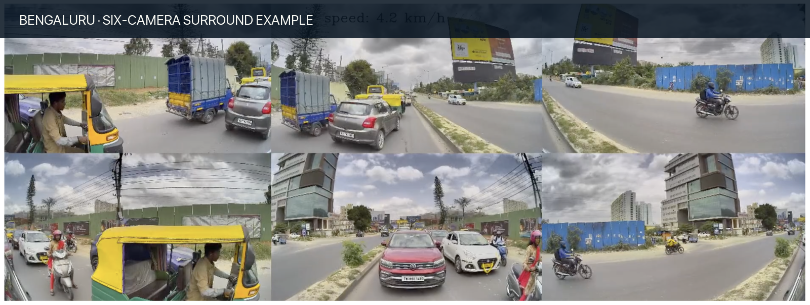
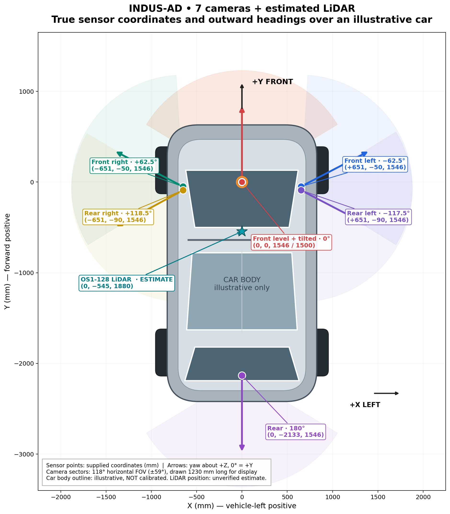
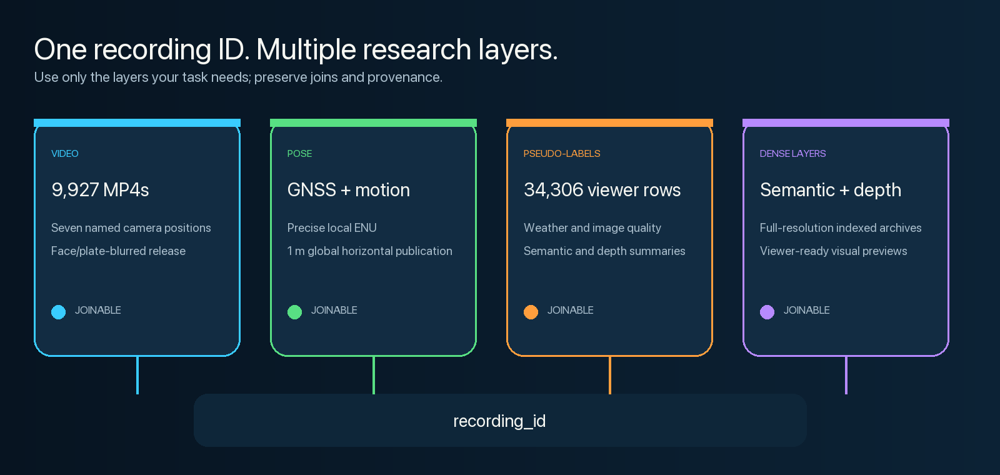

# INDUS-AD Devkit

[](https://www.python.org/)
[](https://github.com/gagandeepreehal/indus-ad-devkit/actions/workflows/ci.yml)
[](https://github.com/gagandeepreehal/indus-ad-devkit/releases/tag/v0.1.2)

[](LICENSE.md)

Build nuScenes-compatible subsets from INDUS-AD. Select camera frames and scenes, interpolate GNSS poses, and export train/test splits with source and selection records.

Exports keep model-generated labels separate from human annotations.

The devkit uses the nuScenes file structure and supports the official loader.

## Quickstart

Use Python 3.12 on Linux or macOS. Request [INDUS-AD access on Hugging Face](https://huggingface.co/datasets/gagandeepreehal/indus-ad) before running the example.

Allow about 209 MB for downloads and 2 GiB of working space, plus the Python environment. The example skips dense semantic and depth archives.

Run from a fresh checkout:

```bash
git clone https://github.com/gagandeepreehal/indus-ad-devkit.git
cd indus-ad-devkit
python3.12 -m venv .venv
source .venv/bin/activate
python -m pip install -e .
hf auth login
cp examples/indus_ad_v21_config.json dataset_config.json
cp examples/indus_ad_annotations.jsonl annotations.jsonl
indus-ad build --config dataset_config.json
indus-ad validate --dataroot var/indus-ad-datasets/v1.0-trainval --version v1.0-trainval
indus-ad inspect --dataroot var/indus-ad-datasets/v1.0-trainval --version v1.0-trainval
```

The example exports 1 scene, 48 samples, and 288 camera images, with 2 joined pseudo-label rows and 4 dense references. A cached macOS build took about 60 seconds. See the [quickstart measurements](docs/quickstart-release.md).

Use `indus-ad` for new commands. Existing scripts can still use `dataset-devkit`.

Use the example configuration from the current checkout.

The official nuScenes loader requires NumPy <2.

## Source dataset



*Six camera views from Bengaluru. [Image source and license](docs/assets/SOURCES.md).*



*Seven-camera rig and Ouster OS1-128 LiDAR mount. Use the dataset calibration tables for projection.*

[INDUS-AD on Hugging Face](https://huggingface.co/datasets/gagandeepreehal/indus-ad)
contains multi-camera driving recordings from Bengaluru, India, with camera timing,
calibration, transformed GNSS/pose tables, and sampled semantic, depth, weather, and
image-quality pseudo-labels joined by `recording_id`.

| Dataset-card snapshot | Value |
| --- | --- |
| Recordings | 1,469 |
| Camera videos | 9,927 MP4s |
| Recording timeline (longest camera per recording) | 85.31 hours |
| Summed camera-view duration | 588.57 hours summed across cameras |
| Camera positions | Six surround cameras; tilted-front video in 1,113 recordings |
| Sampled camera annotation rows | 34,306 |

Source counts are from the [INDUS-AD dataset card](https://huggingface.co/datasets/gagandeepreehal/indus-ad). The devkit creates its own train/test split. See the [dataset privacy and takedown policy](https://huggingface.co/datasets/gagandeepreehal/indus-ad/blob/main/collateral/DATASET_PRIVACY_AND_TAKEDOWN.md).



*[Dataset layers and image attribution](docs/assets/SOURCES.md).*

## Choose a source

All sources require an exact repository ID and a full 40-character commit SHA.

| Source | Schema | Example |
| --- | --- | --- |
| Integrated INDUS-AD with annotations | `2.1`, `indus_ad_hf` | [indus_ad_v21_config.json](examples/indus_ad_v21_config.json) |
| Older decoded V2 layout | `2.0`, `decoded_hf` | [decoded_v2_config.json](examples/decoded_v2_config.json) |
| Original MCAP | `1.0`, `mcap_hf` | [dataset_config.json](examples/dataset_config.json) |

The devkit marks INDUS-AD and decoded V2 as `privacy_transformed` and original MCAP as restricted raw (`restricted_raw`). Manifest verification checks file integrity and published evidence. Anonymization happens before publication.

## Configure a subset

The quickstart selects recording `17-58-38.892-1cafd700d18c4a09a1f9db053c7933c1`. The `quickstart` quota selects one eligible scene. An empty scenario-rules list selects zero scenes.

Create the annotation file at the configured path. It can be empty. For MCAP or decoded V2, replace the example repository IDs and all-zero revisions with your source.

The build checks source artifacts and applies filters, strict quotas, and seeded splits. Motion features for decoded sources use recording-local ENU coordinates.

Camera labels are sparse. Check `join_audit` for labels retained after frame sampling. See the [coverage and join guide](docs/annotation-coverage.md).

Six untilted cameras are selected by default; `cam_front_tilted` is optional. Dense
semantic/depth payloads are metadata-only by default. `selected_frames` modes require
`camera_scalar` and verify dense members after scene selection.

## Output and validation

A successful build publishes `paths.output_dir/v1.0-trainval`:

```text
v1.0-trainval/
├── maps/
├── samples/
├── mz_extensions/
└── v1.0-trainval/       # official JSON tables
```

`mz_extensions/` contains source fingerprints, validity, labels, selection/split
audits, and a content manifest. Integrated weak labels are Parquet tables under
`mz_extensions/indus_ad/`. Official object annotation tables remain empty.
Dense payloads stay in the verified cache; exported rows retain source references
and materialization state. Dense acquisition failures block publication.

```bash
indus-ad validate --dataroot var/indus-ad-datasets/v1.0-trainval --version v1.0-trainval
indus-ad inspect --dataroot var/indus-ad-datasets/v1.0-trainval --version v1.0-trainval
```

These commands use the quickstart output path; adjust it if you change the configuration.
Paths are relative to the configuration file. Outputs are read-only and existing
destinations are never overwritten. Rebuild into a new destination to change content.
Commands emit JSON; configuration errors exit `2`, and operational/validation errors exit `1`.

## Python SDK

```python
from dataset_devkit import Dataset

dataset = Dataset("var/indus-ad-datasets/v1.0-trainval")
scene = dataset.table("scene")[0]
sample = dataset.scene_samples(scene["token"])[0]
front = dataset.camera(sample["token"], "CAM_FRONT")
pose = dataset.ego_pose(front["token"])

# Integrated INDUS-AD output
labels = dataset.camera_annotations(camera_name="cam_front")
if labels:
    weather = labels[0].annotation.weather
```

See the [SDK guide](docs/export.md) for annotation lookups, splits, and audit access.

## Documentation

| Guide | Contents |
| --- | --- |
| [Quickstart verification](docs/quickstart-release.md) | Measured download, disk, runtime, and release provenance |
| [Troubleshooting](docs/troubleshooting.md) | Access, supported Python, source-layout errors, selection and disk usage |
| [Source compatibility](docs/source-compatibility.md) | Per-recording metadata acceptance and unsupported layouts |
| [Production validation](docs/launch-validation.md) | Five representative six-camera build results |
| [Annotation coverage](docs/annotation-coverage.md) | Sparse pseudo-label coverage and exact joins |
| [Integrated INDUS-AD](docs/indus-ad.md) | Annotation layers, joins, dense references, and companion GNSS |
| [Published sensor acceptance](docs/published-sensor-acceptance.md) | Corrected calibration/GNSS compatibility and verification limits |
| [Configuration](docs/configuration.md) | Sources, paths, sensors, and policies |
| [Extraction](docs/extraction.md) | Camera decoding, timestamps, GNSS, and staging |
| [Validity](docs/validity.md) | Quality rules, quarantine, and partial publication |
| [Scenes](docs/scenes.md) | Automatic, annotation-driven, and hybrid scenes |
| [Selection](docs/selection.md) | Features, filters, quotas, and splitting |
| [Export and SDK](docs/export.md) | Tables, extensions, validation, and publication |

## Camera timing and partial recordings

The devkit uses camera `rec_timestamp` (`rec_time_offset_ns`) for frame selection, synchronization, pose queries, and export. Main GNSS uses sensor `timestamp` (`time_offset_ns`). Untimed, quality-flagged GNSS messages mark gaps. The export trims leading gaps and skips internal gaps while preserving valid timestamps. See the [timing and trimming guide](docs/timing-and-trimming.md).

## Limitations

- Camera, calibration, and GNSS inputs are supported; LiDAR ingestion is not.
- Inputs must follow a supported source contract. Arbitrary repositories and symbolic revisions are rejected.
- `v1.0-trainval` is the only publication version. Windows is unsupported.
- Metadata acceptance does not guarantee a usable scene. Quality thresholds and
  minimum scene lengths still apply after trimming untimed GNSS portions.
- Production validation is bounded to selected recordings on macOS. Linux/macOS
  CI covers offline exports; full-corpus video decoding has not been performed.

## Development

```bash
python -m pip install -e '.[dev]'
pytest -q
ruff check src tests
mypy
python -m dataset_devkit.schema
git diff --exit-code schema/dataset_config.schema.json
python -m build --no-isolation
```

For a tiny offline decoded build:

```bash
python tools/decoded_fixture_smoke.py /tmp/dataset-devkit-fixture
```

The fixture destination must be absent; the script prints the published dataroot.

## Citation and license

Cite the source dataset release using its Hugging Face dataset card, and identify
this devkit by repository URL and the release tag or commit used.

The **devkit software** uses the [PolyForm Noncommercial License 1.0.0](LICENSE.md).
Commercial use requires a separate license. See [NOTICE](NOTICE) for copyright information.

The **source dataset and publisher-provided preview assets** have a separate
[CC BY-NC 4.0 license](https://creativecommons.org/licenses/by-nc/4.0/).
See the [dataset card](https://huggingface.co/datasets/gagandeepreehal/indus-ad)
and [asset attribution](docs/assets/SOURCES.md) for scope and attribution.
The software license does not replace the dataset's license or access requirements.
